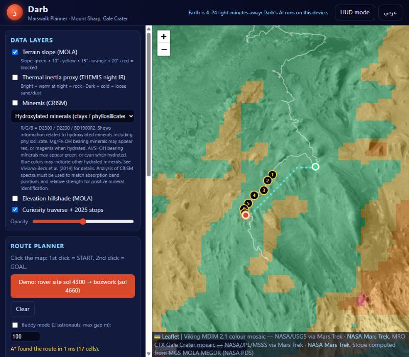
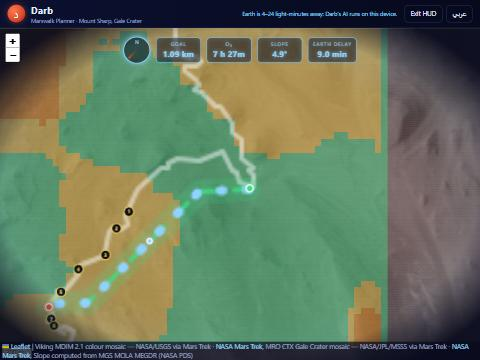

# Darb (دَرْب) — Marswalk Planner

**NASA Space Apps Challenge 2026 · Interplanetary Survival Guide: Martian Map**

*Darb* means "path" in Arabic. Darb is an interactive map that helps an astronaut in a spacesuit plan a
**safe walk on Mars** — from Curiosity's 2024 position to the **boxwork** ridges on Mount Sharp
(Gale Crater) that Curiosity studied in 2025 — using real NASA data. Its AI assistant, **Ask Darb**,
runs **on the device** with no internet, because a message to Earth takes 4–24 minutes each way.



## What it does
- 🗺️ **Mars map** of lower Mount Sharp: NASA Mars Trek tiles (Viking + sharp MRO CTX mosaic).
- 🧩 **Data layers** you can switch on/off:
  terrain slope (HiRISE 1 m elevation, 25 m cells) · rough ground (rocks / small ridges, from the 1 m data) · thermal inertia proxy (THEMIS night IR) · minerals (CRISM, 4 mineral maps + true colour) ·
  elevation hillshade (MOLA) · Curiosity traverse with 8 real 2025 stops.
- 🌡️ **Weather & radiation panel**: latest Curiosity REMS weather + RAD surface dose.
- 🧭 **Route planner**: click START and GOAL → the **A\*** algorithm finds the lowest-cost walk
  (steep = expensive, > 20° = blocked, loose sand = extra cost) and draws a dotted trail.
  A point clicked on too-steep ground moves to the nearest safe spot within 150 m.
- 📋 **Route card**: distance, walking time, round trip, O₂ reserve, climb, max slope, sand, radiation dose,
  and a safety score 🟢 Safe / 🟡 Caution / 🔴 Danger with reasons.
- 📷 **Waypoints**: click a numbered stop (or the route) to see a real Curiosity Navcam photo from that spot and what to look for.
- 🪖 **HUD mode**: helmet-visor view with compass, distance to goal, O₂ timer, slope, Earth delay and warnings; "Simulate walk" animates it.
- 👩‍🚀👨‍🚀 **Buddy mode**: route for two astronauts walking side by side (needs a wider safe corridor).
- 🤖 **Ask Darb**: offline AI (Ollama) grounded on the route and map data; says "I don't know" instead of guessing; shows response time; can look at rover photos.
- 🌐 **English / العربية** toggle (right-to-left layout).



## How to run it on Windows
1. Install **Python 3** from https://www.python.org (tick "Add Python to PATH").
2. Download this project (Code → Download ZIP, then unzip) or `git clone` it.
3. Double-click **`start.bat`**. It starts a small web server and opens http://localhost:8000.
   (Do not open `index.html` directly — browsers block loading the data files that way.)
   Or, in a terminal inside the folder:
   ```bash
   python -m http.server 8000
   ```
4. Click **Demo** in the Route planner, or click two points on the map.

### Optional: turn on Ask Darb (offline AI)
1. Install **Ollama** from https://ollama.com/download (Windows installer).
2. Download a model once (needs internet one time, ~6.6 GB):
   ```bash
   ollama pull qwen3.5:9b
   ```
3. Ollama runs in the background after install (icon in the system tray). If not, start it:
   ```bash
   ollama serve
   ```
4. Reload the app — the Ask Darb dot turns green. Without Ollama the app still works and says "Ask Darb is offline".

## Rebuild the data (optional)
All data files are already in `data/`. To download them again from NASA (Python standard library only):
```bash
python tools/build_data.py
```
The elevation grid uses the USGS HiRISE 1 m DEM of Gale (3.87 GB). If `raw/hirise_dem/MSL_Gale_DEM_Mosaic_1m_v3.tif`
exists it is read locally (~34 s); otherwise only the needed rows are fetched over the internet (slower, no big download).

## Run the tests
```bash
node --test tests
```
Test Ask Darb's answers (Ollama running): open http://localhost:8000/?eval=qwen3.5:9b&runs=3 — results in
[docs/ASK-DARB-EVAL.md](docs/ASK-DARB-EVAL.md) (54/54 correct over 3 runs, 1.9 s per answer).

## Project structure
| Path | What |
|---|---|
| `index.html`, `css/style.css` | page + dark theme |
| `js/app.js` | map, layers, route card, waypoints, HUD, Ask Darb UI |
| `js/route.js` | cost grid + A* + route statistics (also used by the tests) |
| `js/askdarb.js` | talks to the local Ollama server |
| `js/i18n.js`, `js/config.js` | English/Arabic text; settings and tile URLs |
| `data/` | real NASA data prepared for offline use |
| `tools/build_data.py` | rebuilds `data/` from NASA servers |
| `tools/hirise_dem.py` | reads the HiRISE 1 m elevation GeoTIFF (plain Python TIFF + LZW reader) |
| `tools/local_agent.py` | sends simple tasks (review, summaries) to a local model |
| `tests/route.test.js` | 19 unit tests |

## Documents
- [PLAN.md](PLAN.md) — plan, tasks, definition of done
- [SOURCES.md](SOURCES.md) — every dataset with links
- [TEAM-GUIDE.md](TEAM-GUIDE.md) — how every part works, in simple words
- [AI-USAGE.md](AI-USAGE.md) — how AI was used (required by the rules)
- [CHANGELOG.md](CHANGELOG.md) — what changed each round
- [docs/SUBMISSION.md](docs/SUBMISSION.md) — submission text · [docs/PITCH.md](docs/PITCH.md) — pitch + judge Q&A · [docs/DEMO-VIDEO.md](docs/DEMO-VIDEO.md) — demo video / slides

## Honest limits
- Slopes come from the HiRISE 1 m DEM averaged into 25 m cells (within 4.2 m of Curiosity's own recorded elevation).
  Obstacles smaller than a cell — boulders and the 1–2 m boxwork ridges — are not in the slope; a separate
  roughness layer (4 m steps in the 1 m data) flags such areas but not each rock. Next step: rock detection in HiRISE images.
- THEMIS night IR is a *relative* proxy for thermal inertia; CRISM browse colours are qualitative.
- Map tiles are saved offline only for the study area (`tiles/`, ~11 MB); outside it they load from Mars Trek online.
  All data layers, routing and Ask Darb work offline.
- Safety thresholds, walking speed and the 8 h O₂ budget are our own assumptions (listed in SOURCES.md).

Data: NASA / JPL-Caltech / MSSS / ASU / GSFC / USGS, Centro de Astrobiología (REMS). Not an official NASA product.
